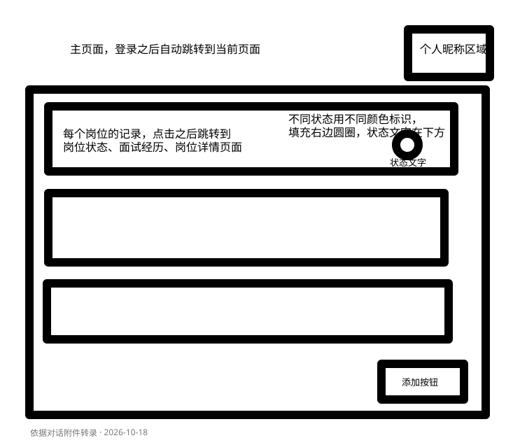
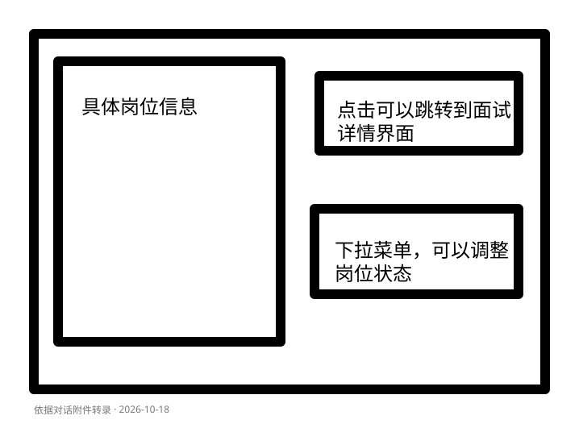

# 页面参考与阶段 1 边界

2026-10-31 免费模型替换完成：原4.6V复测仍1305；4.1V-Thinking-Flash通过真实图片/Java严格草稿及字段匹配，4V-Flash回答未通过草稿规则。本轮已默认切换4.1V，并在项目真实页面连续识别中文、英文两张虚构截图，内容匹配、缺字段留空、额度30→29→28、手动内容保留且列表仍0条。713项后端及JAR、21项前端及构建通过。5.7开发验证完成、待用户重启后端后本机/域名验收；5.8未开始。 详见[免费模型对比](vision-model-alternatives.md)。以下为历史记录。

2026-10-31 审计更正：用户持续1305且控制台显示未使用，不能用此前两次HTTP200元信息宣称项目已成功识别或稳定可用。复核原诊断代码后，按项目配置加载的Key与原模型文件字面值一致、文件自15:56未改；新一轮对照中随机无效Key为401，本机Key的虚构图片请求为429/1305，没有取得可验收草稿。5.7仍未验收，5.8未开始。 见[证据审计](vision-model.md)。以下为历史记录。

2026-10-31 最新核查：用户确认标准Key、控制台显示从未使用后，已直接使用本机配置实测glm-4.6v-flash。最小文本和与项目相同参数的虚构图片请求均HTTP200，返回模型匹配且有completion，证明该Key可调用该模型及图片请求；项目网页再次调用得到明确1305（模型访问量过大），不能归因为Key类型不匹配或要求充值。5.7仍待成功草稿端到端/用户验收，5.8未开始。 本轮无代码/构建变更；详情见[模型联调说明](vision-model.md)。以下为历史记录。

2026-10-31 真实联调更新：用户已确认Key配置完成。后端在隔离H2/Redis环境加载模型配置，两次受控真实请求均返回供应商HTTP429，未获得可验收草稿，未自动重试；5.7仍待账号/限流信息确认及真实识别验收，5.8未开始。补充已知官方429错误码的固定脱敏分类，新增17项测试，全量后端706项（0失败/错误/跳过）及JAR通过。前端本次未改，21项/构建为上次通过记录。 详见[5.7真实联调记录](vision-model.md)。以下为历史记录。

2026-10-31：5.6 已由用户确认理解并授权继续。当前 [5.7 模型识别接口与草稿页面](vision-model.md)已实现并通过隔离验证：固定GLM-4.6V-Flash、开关/私有配置、有界HTTP/超时、不重试、账号重复请求保护、额度后调用及十字段草稿展示。新增33项，全量后端689项（0失败/错误/跳过）及JAR、前端21项及构建通过。用户明确尚无API Key，本轮未调用真实智谱；真实模型权限/效果/域名真机联调待申请并配置Key，5.7尚未完成真实验收，5.8未开始。 草稿只展示、不自动覆盖或保存，前端说明图片将发往智谱；默认关闭，后端启用后才能真实调用。以下为历史记录。

2026-10-31：用户已确认 5.5 显示正确、验收完毕。本轮仅完成 [5.6 原子预占与全站上限](vision-quota-reservation.md)：Lua 同时检查/更新 IP 与全站日计数并在上海零点过期，可信代理链解析和识别前置顺序；默认全站 100 次可配置。新增 48 项，全量后端 656 项（零失败/错误/跳过）、JAR、前端 20 项及构建通过；真实独立 Redis 并发/过期/故障与受控客户端验证通过，无真实模型调用，待本项验收。5.7 及后续未开始。 本项无新UI；原图片检查/额度查询继续只读，手动表单保持可用。实际域名可信代理配置未改动。以下为历史记录。

2026-10-30 当前进度：用户已验收 5.1～5.3c，并在了解 5.4 无新网页、按代码和自动测试验收后明确授权继续。本轮完成 [5.5 Redis 每日额度查询与页面展示](vision-quota.md)，开发与隔离验证通过、待用户本机验收。新增 27 项测试，全量后端 608 项及 JAR、前端 20 项及构建通过；真实 Redis + H2 网页覆盖正常、耗尽、断连降级、恢复及手动保存。只查询不扣额，模型尚未接入；5.6 及后续未开始。 新增页在截图区展示独立额度面板，失败不阻止选图、检查和手动输入；桌面及 375px 隔离布局通过，真实域名/设备待验收。 下方为历史记录。

2026-10-29 验收反馈修正：自有域名图片检查超时、localhost 正常。已将实际图片请求限时从 10 秒改为 60 秒，并明确前置连接校验/上传超时提示及等待说明；5 项前端测试、构建和隔离 15 秒延迟检查通过，真实域名原图待用户复测。Java 未改动，5.3a 仍待验收，见[说明](screenshot-upload.md)。

2026-10-29 最新增量：用户已确认 5.2 验收，本次 [5.3a 基础截图上传](screenshot-upload.md)已开发、待本项验收。新增页手动表单上方提供独立截图选择/预览/替换/移除/主动检查，不识别、不填表、不创建岗位；失败仍可手动保存。桌面/375px 隔离检查通过，各设备系统选择器待本机验收。下方历史待验收状态由本记录更新。

2026-10-29，用户已确认 5.1 验收。本次 [5.2 其余四项字段](job-additional-fields.md)已开发、待本项验收：原新增/编辑页面增加学历、来源、链接和原生日期输入，预填及提交扩为十字段；所有选填项留空清除，链接/日期校验及错误提示接通。472 项后端测试、JAR、前端构建与隔离网页检查通过；真实手机日期选择器待本机验收，截图上传尚未开始。下方六字段和待验收表述为历史记录。

## 当前页面增量：2026-10-28，5.1 已开发、待用户验收

[岗位职责和任职要求](job-description-fields.md)已进入原新增/编辑页面：六字段提交，新增两项为选填多行输入、各最多 10,000 码点，桌面各占整行、700px 以下单列；编辑预填、修改判断、清空和字段错误均接通。详情复用已有纯文本与换行展示。原字段、状态及岗位隔离继续沿用。400 项后端测试、JAR、前端构建及隔离网页检查通过，真实 MySQL/域名/手机等待本机验收；5.2 和截图上传/识别未开始。下方四字段及阶段 5 未实现描述为历史记录。

用户于 2026-10-18 提供两张草图，并确认进入阶段 1。
本文件记录草图约定和阶段 1 历史。2026-10-19 已新增登录/注册页面、退出、当前账号展示，并将静态岗位示例替换为当前用户的真实只读列表与详情，见 [阶段 2 说明](authentication.md)。阶段 1 下方的静态预览描述仅为历史记录。README 仍按用户决定后补。

用户已确认阶段 2 和[最小岗位创建接口](job-creation.md)验收通过。
2026-10-20 已接入[网页新增表单](job-create-form.md)：主页右下角“添加岗位”跳转 `/jobs/new`，
填写四个基本字段后保存并进入详情。表单桌面两列，700px 及以下单列；面试入口仍禁用。
用户已于 2026-10-20 确认本次表单验收完毕，验收结论与开发环境检查分别记录；下方阶段 1 描述继续作为历史记录保留。

用户已确认[状态修改后端接口](job-status.md)验收通过。现已接入[详情页状态操作](job-status-ui.md)：
状态区展示当前确认值，选择新值后点击“保存状态”，提交成功才更新当前状态，并提供成功或错误提示。
状态未变和提交中禁用保存；连接失败导致结果不确定时可重新加载核对。电脑、手机沿用既有详情排列。
用户已于 2026-10-20 确认状态页面验收完毕，与开发验证分别记录。
随后实现[编辑岗位基本信息后端接口](job-update.md)，仅提供 PUT 修改四个基本字段；
用户已于 2026-10-20 确认接口验收通过。现已接入[网页编辑表单](job-edit-form.md)：
详情页“编辑基本信息”进入 `/jobs/{id}/edit`，读取并预填四字段，保存成功后返回详情；
城市、薪资留空会清除原值，电脑两列、手机单列。错误保留草稿，结果不确定时提供重新加载。
用户已于 2026-10-20 确认网页编辑验收通过，与开发检查分别记录。
随后实现[删除岗位后端接口](job-deletion.md)，仅提供 DELETE，当前用户删除自己的岗位成功返回 204；
有关联记录时保留数据库 RESTRICT 规则。用户已于 2026-10-20 确认接口验收通过。
现已接入[网页删除操作](job-delete-ui.md)：详情侧栏状态区之后新增删除区域，展开确认时显示公司和岗位名，
确认后发送 DELETE，成功回列表；结果不确定时通过 GET 核对。手机保持单列，确认按钮可换行排列。
用户已于 2026-10-20 明确确认网页删除正常，验收通过，与开发验证分别记录。
随后实现[关键词搜索后端接口](job-search.md)：GET /api/jobs 可选 keyword，在公司名、岗位名和城市中做包含查询，
当前用户归属与数组响应保持不变。用户已明确确认搜索接口可正确模糊查询，验收通过。
2026-10-21 已接入[网页搜索框](job-search-ui.md)：列表标题下支持输入、搜索/回车、清空与无匹配提示，
结果标明已生效关键词；新请求优先于旧响应，失败可重试提交条件。手机输入与按钮分行排列。
用户已于 2026-10-21 确认网页搜索验收完成，开发验证与用户验收分别记录。
2026-10-21 已完成[状态筛选接口与页面](job-status-filter.md)：列表新增投递状态下拉框，点击搜索时与关键词同时生效，
“全部状态”仅取消状态限制；原清空按钮调整为“重置条件”，同时清除两项条件。结果显示生效条件，无匹配可恢复全部。
本次后端自动测试、隔离 H2 浏览器验证与用户 MySQL、实际域名、真实手机验收分别记录；状态筛选的逐项验收结果尚未单独补充，用户随后要求继续剩余阶段 3。
2026-10-21 已完成[分页接口与页面](job-pagination.md)：默认每页 10 条，可选 20/50，列表底部提供上一页、下一页、页码及范围，
标题旁区分匹配总数与本页条数。翻页保留已提交筛选，搜索/重置/切换条数回第 1 页；刷新恢复默认条件。
列表接口改为分页对象，前端已同步。用户已于 2026-10-21 明确确认阶段 3 验收完毕，包含分页和阶段 3 全流程；具体设备的逐项结果不额外推断。阶段 4 尚未开始，将在新聊天依照[交接说明](stage4-handoff.md)继续。

## 阶段 4 页面增量（2026-10-27，已由用户验收）

已接入[新增并查看面试轮次](interview-rounds.md)：原详情页右侧面试占位区替换为轮次列表与展开式新增表单，
支持轮次号、可选时间/类型/结果/整体复盘；保存成功后重新查询列表，按轮次号及 ID 升序显示。
用户完成初版验收后要求先拒绝重复轮次，再改为一轮一页。用户已确认[重复轮次修正](interview-round-duplicates.md)验收通过：
重复 POST 提示并保留草稿，不保存、不覆盖，随后 GET 刷新列表；已有历史重复记录保留。
用户随后授权完成剩余要求，现已接入[一轮一页](interview-round-pagination.md)：固定每页一条，上一轮/下一轮与实际页码，编号与页码分开。
已接入[编辑本轮](interview-round-update.md)：预填五字段、取消、保存、清空选填项、改号查重，成功后按记录 ID 定位新页。
支持空态、错误/原页重试、字段提示、保存期间操作互斥及结果不确定时的 GET 核对。编辑草稿期间禁用翻页，页面刷新恢复第 1 页。
桌面左侧岗位信息、右侧[完整名称切换栏](job-detail-tabs.md)：01 面试轮次与回顾、02 投递状态、03 岗位管理，只显示所选面板，默认第一项；700px 以下岗位信息后显示切换栏与当前面板，不再将三个面板全部纵向展开。
轮次组件位于 InterviewRoundsPanel.vue，由 JobDetailView.vue 传入岗位 ID 和可选 roundId 定位；当前已新增独立回顾路由，见下方增量。
已接入[删除本轮与岗位关联删除](interview-deletion-plan.md)：轮次卡片按钮展开确认，默认聚焦取消，确认才发送 DELETE；删除后 GET 重取一轮一页并修正末页。删除最后一轮显示空态，岗位保留。响应不确定时只读核对，仍在则重新确认，核对失败继续禁止写入。岗位删除确认明确会清理全部轮次和问题，成功回列表；两类确认和提交均与其他写入互斥。
用户已确认删除功能验收通过。[新增并查看问题](interview-questions.md)按本次反馈调整为[面试回顾独立页](interview-review-page.md)：当前轮次信息右侧放“面试回顾”，详情不直接展开问题；没有轮次时不显示回顾入口，保留原新增轮次空态。
回顾路由 `/jobs/{id}/interview-rounds/{roundId}/review` 先核对对应关系，再显示该轮问题和主题、默认折叠回答/复盘，沿用每页 10 条分页及新增四字段表单。无问题时保留“无面试过程记录”和“添加记录”；错误不当作空态。返回详情按 roundId 定位原轮次。草稿/保存/不确定时返回入口禁用，响应丢失先只读核对；轮次编辑或删除确认期间回顾入口禁用。窄屏仍把入口放轮次右侧，独立页单列。
2026-10-23 用户已确认新增/查看与回顾页验收。本次新增[问题右侧编辑/删除](interview-question-actions.md)：编辑在上、删除在下，编辑预填并可清空选填项，删除确认明确目标，成功重取列表与修正末页；操作/不确定期间保护其他写入与返回。详情三个栏目用 v-show 保留轮次页码/状态选择，草稿/确认/提交/不确定时不能切走。
2026-10-27 用户已验收问题编辑/删除及栏目切换。本次回顾页新增[当前轮次问题搜索](interview-question-search.md)：四字段包含查询，搜索/回车/清空回第 1 页、匹配总数与条件展示、无匹配说明；每页 10 条，翻页和读取失败重试沿用提交条件，输入草稿不立即过滤。草稿/确认/不确定时禁用搜索，写入后保留条件，未匹配记录仍明确提示保存成功；结果不确定时清空搜索再只读核对。手机搜索输入独占一行、两个按钮并排，问题右侧动作不变。
用户已于 2026-10-27 确认关键词搜索验收。本次增加[知识主题筛选](interview-topic-filter.md)下拉框，默认全部主题；选项来自本人本轮全部非空主题，不受关键词或页码影响，主题按完整名称不区分大小写匹配，与关键词一起点击搜索生效。原清空按钮改为重置条件，同时清两项；选择全部主题只取消主题限制。匹配说明展示两项条件，翻页/重试保留提交条件，新增/编辑/删除后更新选项，最后一条该主题改名或删除后保留无匹配条件，不静默取消。异常只读核对重置两项条件，草稿/确认期间锁定。窄屏输入、主题各一行，两个按钮并排。
用户已于 2026-10-27 明确确认验收完毕，主题筛选及阶段 4 验收通过；不推断设备逐项结果。阶段 5 目前只完成[任务规划](stage5-plan.md)，尚未实现。自动测试和隔离网页检查与用户验收分别记录。
上方“阶段 4 尚未开始”以及下方阶段 1 禁用入口描述均为历史交付记录，当前功能以本节与功能说明为准。

## 草图存档

以下 SVG 是依据对话附件制作的结构转录版，不是附件原始图片文件。
原始图片保留在本次对话中；转录版用于在仓库内长期记录布局意图。

### 图一：主页



- 登录成功后默认进入此页面；登录跳转在阶段 2 实现。
- 右上角为个人昵称区域。具体显示字段在登录阶段确定，当前不新增用户字段。
- 主体为纵向排列的岗位卡片。电脑端也采用卡片布局，遵循本次草图。
- 点击一张岗位卡片进入对应岗位详情。
- 每张卡片右侧使用有颜色的实心圆点，下方显示状态文字；不能只依赖颜色区分。
- 列表右下方放“添加岗位”按钮。
- 手机端保持纵向卡片，压缩留白、允许文字换行，状态仍位于卡片右侧。

### 图二：岗位详情



- 电脑端左侧为岗位详细信息。
- 右侧上方为面试记录入口，后续进入该岗位的面试轮次和问题记录。
- 右侧下方为状态下拉菜单。
- 手机端改为单列，顺序为岗位信息、面试入口、状态选择。
- 添加返回岗位列表的入口。

## 页面与接口的数据流

```text
主页岗位卡片 → 岗位详情 → 面试记录（阶段 4）
     ↓              ↓
新增岗位表单    状态修改（阶段 3）
（阶段 3）
```

阶段 1 的真实请求只有：

```text
浏览器 ConnectionStatus.vue
  → GET /api/health
  → Vite 将 /api 原样代理到 127.0.0.1:8082
  → Spring Security 允许匿名 GET 健康检查
  → HealthController 从连接池获取连接并验证
  → JSON 状态返回页面
```

- 连通时：HTTP 200，`{"status":"UP","database":"UP"}`。
- 数据库连接失败或无效时：HTTP 503，`{"status":"DOWN","database":"DOWN"}`。
- 不返回连接地址、账号、密码或异常内容，不读取用户业务记录。
- 此处记录阶段 1 的规则；阶段 2 新增了匿名获取 CSRF Token 和注册入口，其余请求仍要求身份认证，CSRF 保护保留。

## 本阶段已实现与未实现

已实现：Vue 基础工程、主页和详情布局预览、页面路由、响应式 CSS、健康检查与开发代理。

当前路由 `/jobs/preview` 是固定示例预览，并非真实岗位 ID。
示例数据只存在于前端模板中，不读取、写入数据库，也不存入浏览器存储。
添加岗位、查看面试、状态下拉均禁用，并显示对应后续阶段。

登录、昵称、真实岗位增删改查、筛选分页、面试复盘、截图识别、独立概览页面和部署尚未实现。
本次也不配置 Cloudflare Tunnel 或 Nginx。

## 本地运行与手动检查

1. IDEA 运行 `JobSpringApplication`，使用 JDK 17，Working directory 为 `job_spring` 项目根目录。
2. 保留 `config/application-local.yaml` 中的本地密码；该文件已被 Git 忽略，不要提交。
3. 在 `frontend` 目录首次执行 `npm ci`，之后执行 `npm run dev`。Node 使用已验证的 24.22.0。
4. 电脑打开 `http://localhost:5173`，页面底部应显示“后端与数据库已连通”。可以点击“重新检测”。
5. 打开开发者工具 Network，确认 `/api/health` 为 HTTP 200，响应包含 `UP`。
6. 点击示例卡片，检查详情左右布局；点击“返回岗位列表”返回主页；直接刷新详情也应可打开。
7. 手机与电脑连接同一局域网，打开 Vite 输出的 Network 地址（电脑局域网 IP 加 `:5173`），不能使用手机自己的 localhost。
8. 在手机宽度检查详情上下排列、按钮可见且无横向滚动；真实手机访问仍需手动验收。
9. 停止后端后点击“重新检测”，页面应显示未就绪并可重试。重新从 IDEA 启动后再次检测。
10. 添加岗位、面试入口和状态选择应保持禁用，不能产生保存成功的提示。

后端在 `application.yaml` 中配置端口为 8082，Vite 严格使用 5173。若 IDEA 改了后端端口，需要同步修改 `frontend/vite.config.js` 的代理目标。
开发代理只在 `npm run dev` 时生效，生产构建的 API 转发留到部署阶段配置。

## 本次固定的前端版本

- Vue：3.5.44
- Vue Router：4.6.4
- Vite：8.3.4
- @vitejs/plugin-vue：6.0.10

直接依赖固定版本，传递依赖由 `frontend/package-lock.json` 锁定。

## 2026-10-18 验证记录

- `npm run build` 通过。
- Java 17 下 `./mvnw test` 通过，共 5 项测试，覆盖健康接口、连接失效、异常信息不外泄和其他接口的认证限制。
- 用户从 IDEA 重新启动后，实际访问 Vite 的 `/api/health` 得到 HTTP 200 和数据库 `UP`；`/api/jobs` 得到 HTTP 401。
- 浏览器在 1280px 与 375px 视口下检查主页和详情：无横向溢出，详情按断点切换为两列或单列。
- 已检查示例卡片跳转、详情直接刷新和返回主页。
- 真实手机局域网访问、手动停止后端后的重试流程仍需用户验收，不能视为已完成。
- 验证时未新增或修改数据库业务记录。
- 随后按用户要求将后端和代理目标统一改为 8082；上述实际链路验证发生在端口调整前，修改后需重新从 IDEA 启动并复核。
